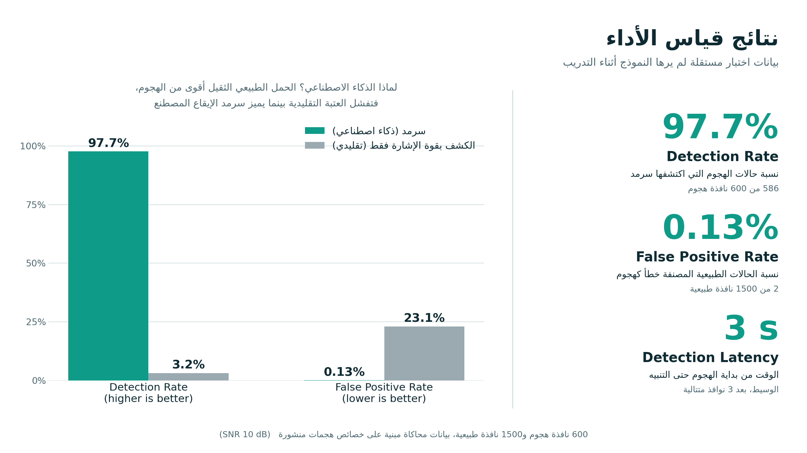
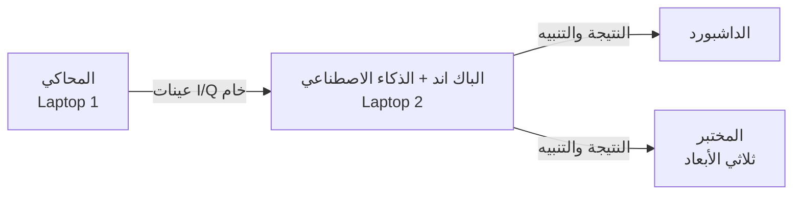
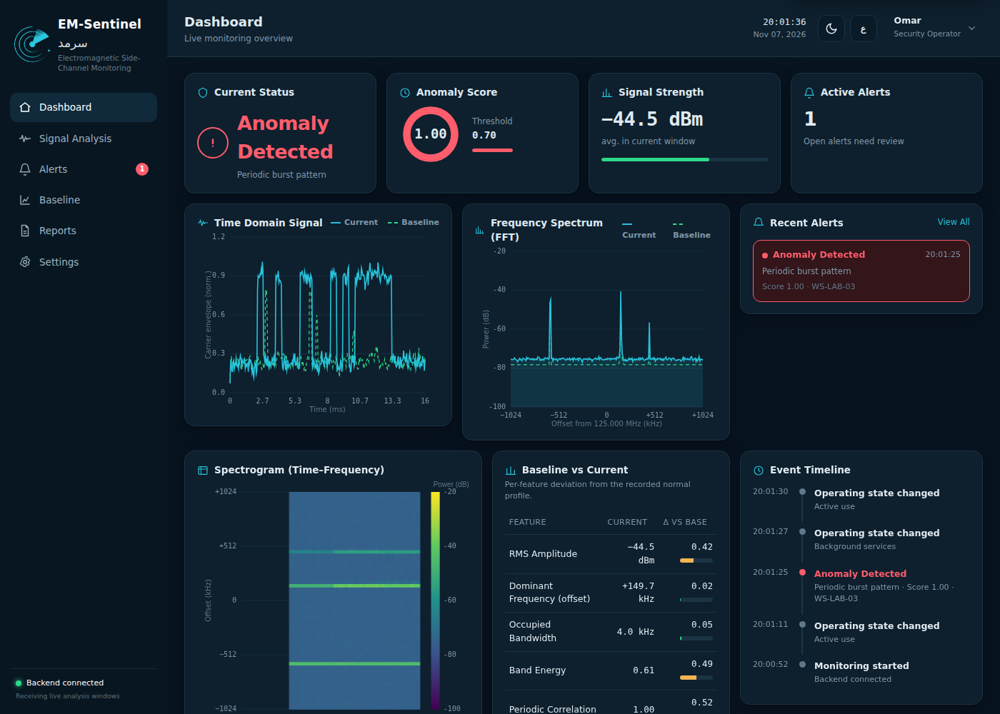
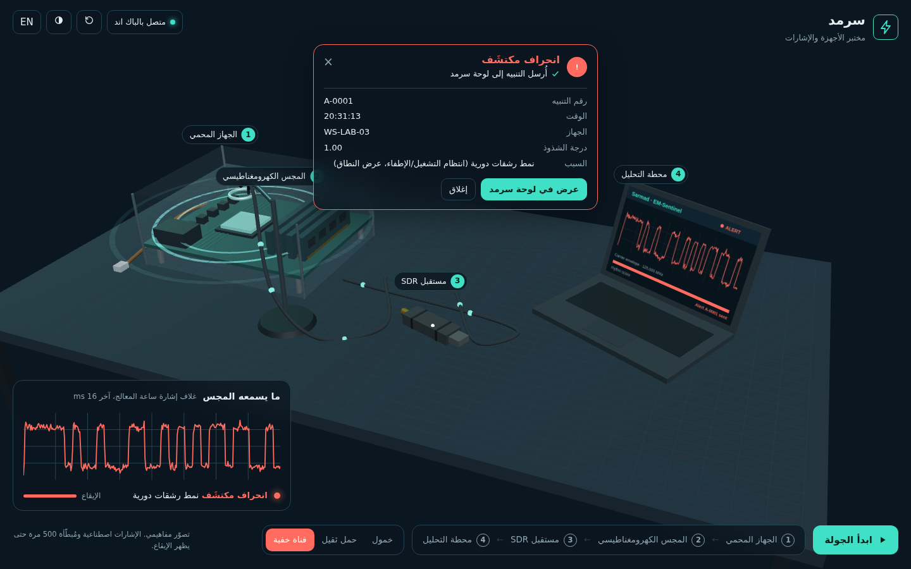
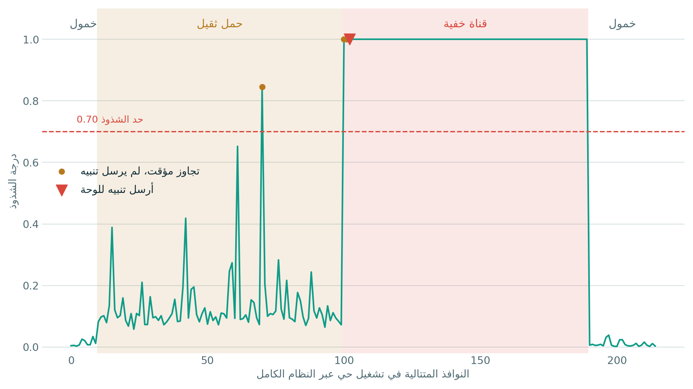

<div dir="rtl">

# سرمد · EM-Sentinel

[English](README.md) · مشروع لهاكاثون IS CyberNext (مسار الذكاء الاصطناعي والأمن السيبراني)

</div>

<div align="center">

## ▶️ [شاهد العرض المباشر · مختبر سرمد ثلاثي الأبعاد](https://sarmad-lab-3d.vercel.app/)

<p dir="rtl">بدون تثبيت وبدون سيرفر: اضغط الرابط واستكشف مختبر الأجهزة والإشارات ثلاثي الأبعاد (وضع العرض).</p>

🎥 [فيديو شرح المشروع](docs/videos/sarmad-intro.mp4) · 🎬 [فيديو طريقة التشغيل (Tutorial)](docs/videos/sarmad-demo.mp4)

</div>



<div dir="rtl">

نظام يكشف تسريب البيانات من الأجهزة المعزولة عبر انبعاثاتها الكهرومغناطيسية، بالبحث عن **الإيقاع المنتظم المصطنع** الذي تحتاجه أي قناة خفية، ودون تثبيت أي شيء على الجهاز المحمي.

## كيف يعمل

</div>



<div dir="rtl">

## التشغيل السريع

</div>

```bash
pip install -r requirements.txt
python train.py
python evaluate.py
run_backend.bat
```

<div dir="rtl">

| الأمر | ماذا يفعل |
|---|---|
| `pip install -r requirements.txt` | تثبيت المكتبات المطلوبة |
| `python train.py` | تدريب النموذج على السلوك الطبيعي فقط (حوالي 30 ثانية) |
| `python evaluate.py` | التقييم على بيانات اختبار مستقلة، والنتائج في مجلد `eval` |
| `run_backend.bat` | تشغيل الباك اند على ويندوز، وعلى ماك ولينكس: `sh run_backend.sh` |

### فتح الصفحات

| الصفحة | الرابط | الجهاز |
|---|---|---|
| الداشبورد | `http://localhost:8000` | لابتوب 2 (دخول تجريبي: الرقم `102234` وكلمة المرور `123123`) |
| المحاكي | `http://IP:8000/simulator` | لابتوب 1، ويتصل تلقائيًا |
| المختبر ثلاثي الأبعاد | `http://IP:8000/lab` | أي جهاز |

حيث **IP** هو عنوان لابتوب 2. لمعرفته: على ويندوز `ipconfig`، وعلى ماك `ipconfig getifaddr en0`.

- **الجدار الناري:** اسمح لبايثون على الشبكات الخاصة، ويفضَّل هوتسبوت جوال للجهازين.
- **بديل بدون متصفح للمحاكي:**

</div>

```bash
python sim_client.py --url ws://IP:8000/ws/sim --mode demo
```

<div dir="rtl">

- **المختبر ثلاثي الأبعاد:** أزرار «خمول / حمل ثقيل / قناة خفية» تغيّر سيناريو المحاكي فعليًا، والحكم والمنحنى يأتيان من التحليل الحقيقي. عند الانحراف يظهر في المختبر تنبيه بنفس رقم التنبيه ووقته في الداشبورد، وزر «عرض في لوحة سرمد» يفتح صفحة التنبيهات.
- إذا فُتح المختبر من رابطه المنشور أو كملف، يعمل في «وضع العرض» بدون اتصال.

| الداشبورد أثناء الهجوم | التنبيه في المختبر ثلاثي الأبعاد |
|---|---|
|  |  |

## مكونات المشروع

| الملف | الدور |
|---|---|
| `sarmad/signals.py` | نموذج الإشارة: حاملات ساعة المعالج تتغير مع النشاط، والقناة الخفية تشغيل وإطفاء بساعة رموز ثابتة |
| `sarmad/features.py` | معالجة الإشارة: الطيف (Welch)، وتتبع الحامل، واستخراج الغلاف، وخصائص التوقيت |
| `sarmad/model.py` | الذكاء الاصطناعي: كشف الجديد بـ k-NN مع معايرة إحصائية، وتصنيف حالة التشغيل، وتفسير التنبيه |
| `sarmad/engine.py` | المعالجة اللحظية: الاستمرارية، والتنبيهات، وإعادة المعايرة، وسجل القرارات |
| `server.py` | خادم FastAPI مع WebSockets و REST، ويقدّم صفحات الداشبورد والمحاكي والمختبر |
| `simulator/index.html` | محاكي المتصفح (لابتوب 1) بنفس الفيزياء، مع سجل الحقيقة الأرضية |
| `lab/index.html` و `vendor/` | المختبر ثلاثي الأبعاد (مكتبة three.js محفوظة محليًا إذا لم يتوفر إنترنت) |
| `dashboard/index.html` | الداشبورد، ويعمل وحده ببث تجريبي إذا لم يتصل بالباك اند |
| `train.py` و `evaluate.py` | التدريب والتقييم |
| `sim_client.py` و `score_run.py` | محاكي سطر أوامر، وقياس أداء تشغيل حي |

## خصائص الإشارة

| الخاصية | المعنى |
|---|---|
| `periodicity` | تماسك توقيت لحظات التبديل (اختبار Rayleigh): قريب من 1 إذا كانت كل التبديلات على ساعة واحدة |
| `onoff_regularity` | هل أطوال فترات التشغيل والإطفاء مضاعفات صحيحة لدورة الرمز؟ |
| `bimodality` | هل للغلاف مستويان واضحان؟ (Otsu) |
| `env_cv` و `rms_dbm` و `band_energy` و `bandwidth_khz` و `spectral_flatness` | الطاقة وشكل الطيف |

## النتائج

على بيانات اختبار مستقلة (بذرة عشوائية جديدة، 1,500 نافذة طبيعية و600 نافذة هجوم لكل مستوى ضوضاء). المصدر: `eval/metrics.json`.

| عند 10 dB | سرمد (k-NN) | Isolation Forest | قوة الإشارة فقط |
|---|---|---|---|
| معدل الاكتشاف | **97.7٪** | — | 3.2٪ |
| الإنذارات الكاذبة | **0.13٪** | — | 23.1٪ |
| ROC AUC | **0.999** | 0.996 | 0.54 |
| زمن الكشف (الوسيط) | **3 ثوانٍ** | — | — |

- في التشغيل الحي (حوالي 1,900 نافذة): اكتُشفت الهجمات الخمسة كلها خلال 3 ثوانٍ، بدون أي إنذار كاذب.
- القناة الخفية السريعة: اكتشاف 100٪، والقناة المتخفية (البطيئة): 95٪.
- الكشف بقوة الإشارة وحدها شبه عشوائي، لأن العمل الطبيعي الثقيل أقوى من إشارة الهجوم.
- **الحدود بصراحة:** عند 0 dB، وهو خارج نطاق التدريب (5 إلى 20 dB)، ترتفع الإنذارات الكاذبة إلى 63٪، لذلك يجب إعادة المعايرة عند تغيّر البيئة. والمحاكاة أنظف من الواقع، فالأرقام على عتاد حقيقي ستكون أقل.



## قياس تشغيل حي

1. شغّل المحاكي بوضع **عشوائي** عدة دقائق، ثم اضغط «تنزيل CSV».
2. شغّل الأمر التالي:

</div>

```bash
python score_run.py truth-XXXX.csv logs/decisions-XXXX.csv
```

<div dir="rtl">

## اتفاقية الرسائل

| الاتجاه | الرسائل |
|---|---|
| المحاكي ← الباك اند | إطار ثنائي فيه ترويسة JSON ثم عينات `float32` بصيغة I,Q، وبدون أي تصنيف |
| الباك اند ← الداشبورد | `window` لكل نافذة، و`alert` عند التنبيه، و`baseline` بعد المعايرة |
| الداشبورد ← الباك اند | `config` و `ack_all` و `recalibrate` |
| المختبر ← الباك اند ← المحاكي | `scenario` لتغيير السيناريو (خمول، نشاط، قناة خفية) |

صيغة الإطار الثنائي:

</div>

```text
[uint32 header length][JSON header][pad to 4 bytes][float32 I,Q,I,Q,...]
header: {type:"samples", seq, ts, fs, center_mhz, n, probe, format:"f32_iq"}
```

<div dir="rtl">

## ملاحظات

- إعادة المعايرة تستبدل نوافذ الحالة المختارة بالتقاط جديد، وتعيد التدريب في الذاكرة فقط (يرجع النموذج الأصلي عند إعادة تشغيل الخادم). نفّذها والجهاز في حالة طبيعية مؤكدة.
- **للانتقال للعتاد الحقيقي:** استبدل المحاكي ببرنامج يقرأ من RTL-SDR (مكتبة `pyrtlsdr`) ويرسل نفس الإطار إلى `/ws/sim`. بقية النظام لا يتغير.

</div>
