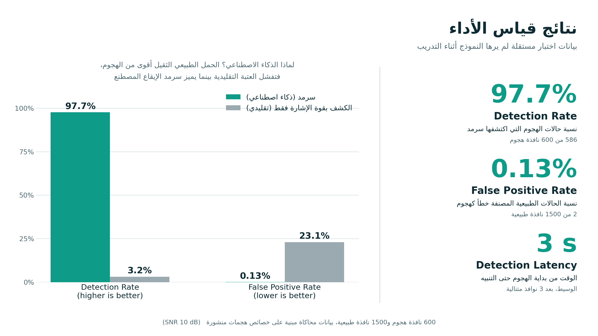
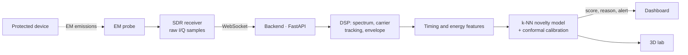
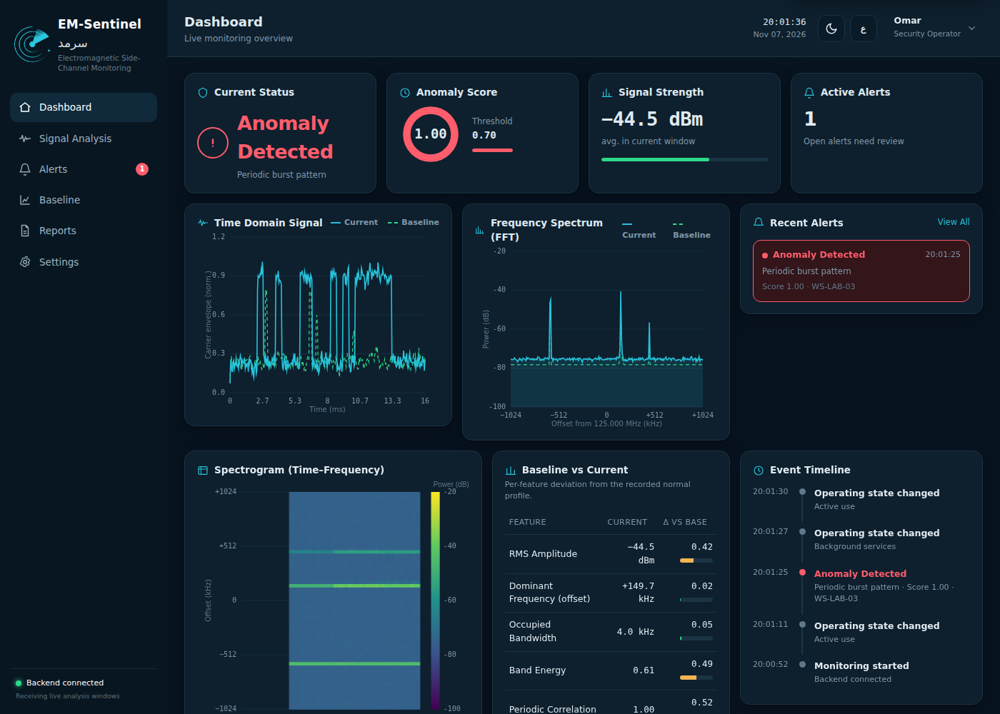
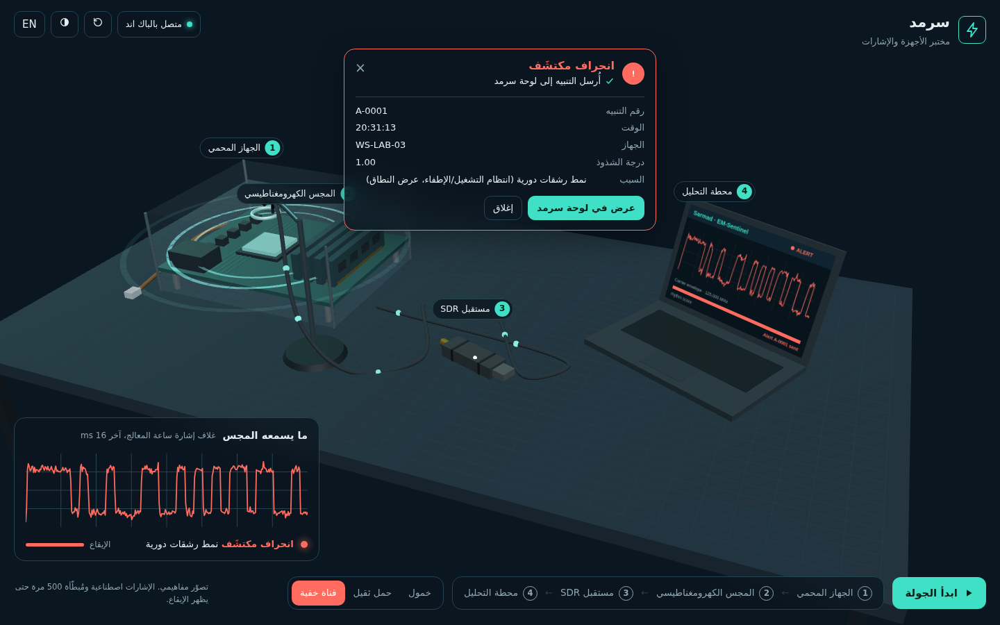
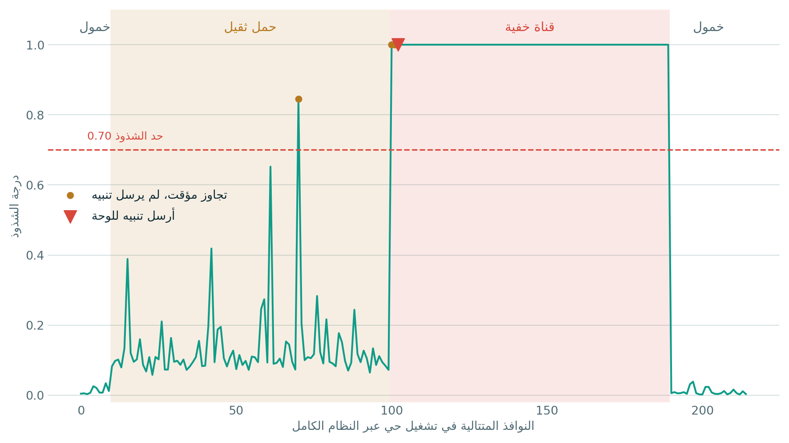

# Sarmad · EM-Sentinel

> Detects data leaking from air-gapped computers through their electromagnetic emissions, using AI that learns a device's normal behaviour, without installing anything on the protected machine.

[العربية](README.ar.md) · Built for the IS CyberNext hackathon (AI & Cybersecurity track)

<div align="center">

## ▶️ [Live Demo · Sarmad 3D Lab](https://sarmad-lab-3d.vercel.app/)

No install, no server: open the link and explore the devices-and-signals lab in 3D (presentation mode).

🎥 [Project overview video](docs/videos/sarmad-intro.mp4) · 🎬 [System walkthrough video (Tutorial)](docs/videos/sarmad-demo.mp4)

</div>



##  Why We Built This

Air-gapped machines (no network, no USB) are the last line of defence for sensitive data. Published research, such as the RAMBO attack (2024), shows that malware inside such a machine can still leak data by switching CPU and memory activity on and off so that it radiates a signal a nearby receiver can decode. Network security tools never see this, because nothing crosses a network.

##  Features

- **Passive, external monitoring.** An EM probe and an SDR receiver sit next to the device; nothing is installed on it.
- **Detects rhythm, not loudness.** A covert channel must switch on a fixed clock so its receiver can decode it. Sarmad measures that regularity, so heavy normal work does not trigger alarms.
- **AI trained on normal behaviour only.** It never sees an attack during training, so it can flag patterns it has never seen.
- **Explainable alerts.** Each alert names the features that deviated from the baseline of the current operating state.
- **One alert per incident.** An alert fires only after 3 consecutive anomalous windows, and a new incident starts only after 10 normal ones.
- **Live dashboard, 3D lab and signal simulator** connected over WebSockets.

##  Architecture



In this prototype the probe and SDR are replaced by a **signal simulator** that produces the same raw I/Q frames, built on published attack characteristics. The backend does not change when a real SDR is connected.

##  Tech Stack

| Technology | Purpose |
|---|---|
| Python 3.10+ | Core language |
| FastAPI + WebSockets | Real-time hub between simulator, dashboard and lab |
| NumPy, SciPy | Signal processing (Welch spectrum, demodulation, decimation) |
| scikit-learn | k-NN novelty detection, Isolation Forest (comparison), state classifier |
| HTML, CSS, JavaScript | Dashboard and browser simulator |
| three.js | Interactive 3D devices-and-signals lab |
| Matplotlib | Evaluation figures |

##  Installation & Setup

```bash
# 1. Clone the repository
git clone https://github.com/nihalalarifi/sarmad-em-sentinel.git
cd sarmad-em-sentinel

# 2. Create a virtual environment and install dependencies
python3 -m venv .venv
source .venv/bin/activate          # Windows: .venv\Scripts\activate
pip install -r requirements.txt

# 3. Train the model on normal behaviour (about 30 s)
python train.py

# 4. Start the backend
python -m uvicorn server:app --host 0.0.0.0 --port 8000
```

##  Usage

Open these pages (from another machine on the same network, replace `localhost` with the backend's IP):

| Page | URL | Role |
|---|---|---|
| Dashboard | `http://localhost:8000/` | Live monitoring, alerts, baselines, reports (demo login: `102234` / `123123`) |
| Simulator | `http://localhost:8000/simulator` | Sends raw I/Q windows; keeps the ground truth locally |
| 3D lab | `http://localhost:8000/lab` | Its mode buttons drive the simulator; real alerts appear here and on the dashboard at the same moment |

Demo flow: in the lab choose **Heavy work** (signal gets stronger, status stays green), then **Covert channel** (alert after about 3 s, with the same ID and time on the dashboard).

| Dashboard during an attack | Alert in the 3D lab |
|---|---|
|  |  |

##  Results

Evaluated on an independent test set (new random seed, 1,500 normal and 600 attack windows per noise level), then end-to-end through the live system.

| At SNR 10 dB | Sarmad (k-NN) | Isolation Forest | Signal strength only |
|---|---|---|---|
| Detection Rate | **97.7%** (95% CI 96.1–98.6%) | — | 3.2% |
| False Positive Rate | **0.13%** (95% CI 0.04–0.48%) | — | 23.1% |
| ROC AUC | **0.999** | 0.996 | 0.54 |
| Detection Latency (median) | **3 s** | — | — |

Every complete attack was caught, with no false alerts after the persistence rule. In live runs (about 1,900 windows) all 5 attacks were caught within 3 s, with no false alerts.



Reproduce: `python evaluate.py && python make_figures.py`. Score a live run: `python score_run.py <truth.csv> logs/decisions-*.csv`.

**Limitations.** Results come from simulated signals, which are cleaner than real hardware. At 0 dB SNR, outside the training range, false positives rise to 63%, so the system must be recalibrated for each installation (supported from the dashboard). The stealth channel (slow, shallow keying) is harder: 95% at 10 dB, 80% at 0 dB.

##  Technical Challenge

**Telling an attack apart from heavy normal work.** Heavy work produces a *stronger* signal than the covert channel, so a signal-strength threshold is close to random (AUC 0.54). We moved from loudness to timing: the switching instants of the demodulated carrier envelope are tested for phase coherence across candidate symbol rates (a Rayleigh test). Natural activity switches at random instants (low coherence); covert keying lands on a fixed clock (coherence near 1).

**Choosing a model whose scores can be thresholded.** Our first choice, Isolation Forest, separated the classes (AUC 0.996), but its scores saturate, so attacks sat only slightly above the most unusual normal windows and no fixed threshold was reliable. We switched to k-NN novelty detection (distance to the learned normal behaviour) and calibrated it with conformal p-values on held-out normal windows, so a score of 0.70 means roughly 1 in 600 normal windows would look this unusual.

##  Project Structure

```
sarmad/        signals.py · features.py · model.py · engine.py · dataset.py
server.py      FastAPI app: /ws/sim, /ws, /api/*, pages
train.py       train on normal behaviour        evaluate.py   test set + figures
sim_client.py  command-line simulator           score_run.py  measure a live run
dashboard/     monitoring dashboard             simulator/    browser simulator
lab/ vendor/   3D lab (three.js bundled offline) eval/         metrics and figures
```

##  Next Steps

Replace the simulator with an RTL-SDR reader (`pyrtlsdr`) that sends the same frames to `/ws/sim`, then validate on real hardware.

##  License

MIT
